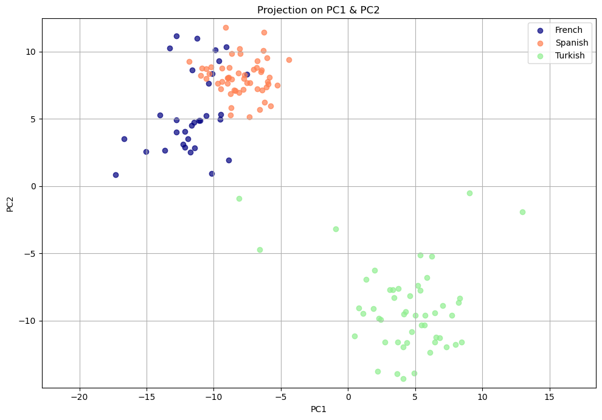
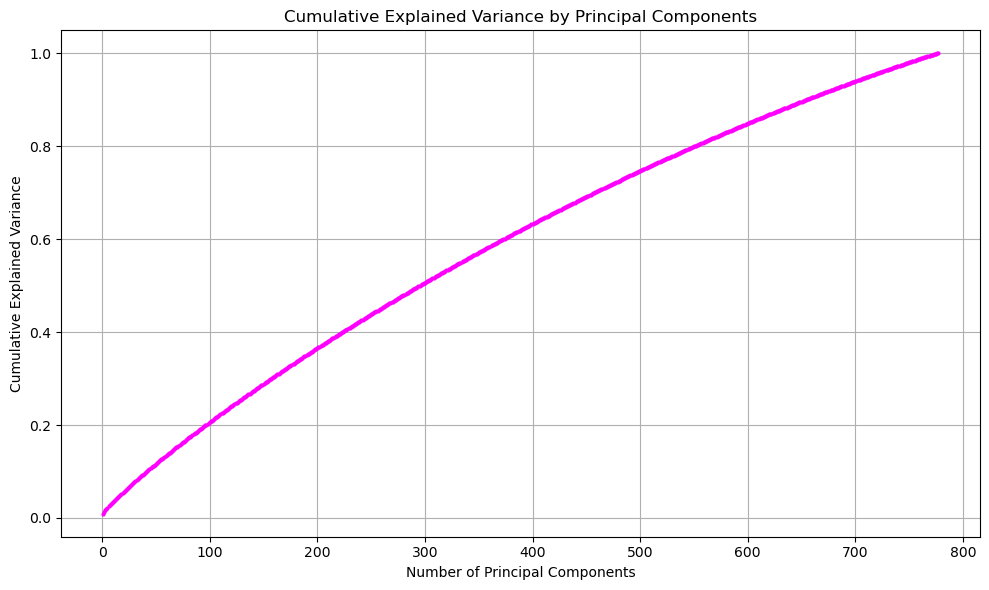
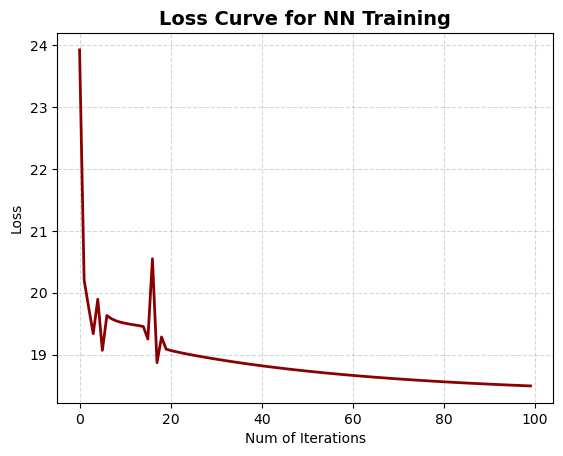

# Can DNA Tell French from Spanish People?

**Do people from neighbouring countries differ in their DNA, and can a model learn to tell them apart?**

A two-step investigation on the same genetic data: first **principal component analysis (PCA)** to see whether populations separate at all, then a **neural network written from scratch** that tries to classify individuals as French or Spanish from their genotypes.



*Each dot is a person, placed by the first two principal components of 20,000 genetic markers. Turkish individuals (green) form their own cluster, while French (navy) and Spanish (orange) people sit close together and partly overlap, mirroring geography.*

## Part 1: Do the populations differ genetically? (PCA)

[Notebook](1_pca_populations.ipynb) · [Script](1_pca_populations.py)

- **Data:** 777 people genotyped at 20,000 SNPs (single-letter DNA variants), including French, Spanish and Turkish individuals. Markers with zero variance were removed first.
- **Geography shows up in DNA.** The first two components separate Turkish people clearly from the other two groups, while French and Spanish overlap.
- **A paradox.** Those two components explain only **1.3%** of the total genetic variation, yet they still separate the populations. Genetic variation is spread across a huge number of small effects: **296 components** are needed to explain half of it.
- **A marker of interest.** Among the markers that weigh most on the leading components is rs906815, which has been linked to rheumatoid arthritis.

## Part 2: Can a neural network tell French from Spanish? (from scratch)

[Notebook](2_neural_network_from_scratch.ipynb) · [Script](2_neural_network_from_scratch.py)

- **Built by hand.** A neural network with one hidden layer, written in NumPy without any machine-learning library: sigmoid activations, the forward pass, backpropagation and the training loop.
- **Measured with MCC.** The Matthews correlation coefficient was used rather than accuracy, because it stays honest when the two classes are unequal in size.
- **A hard problem, as PCA predicted.** The best result, an MCC of **0.32**, came from training on 50% of the data. With more training data the model generalised worse, falling to 0 at 90%, which points to overfitting on a small sample. This fits Part 1: French and Spanish genomes overlap so much that telling them apart is genuinely difficult.

| Variance explained as components are added | Training loss of the network |
|:---:|:---:|
|  |  |

## How to run

Python with `numpy`, `pandas`, `matplotlib` and `scikit-learn`. The genotype data is in [`data/`](data): `geno`, `ind` and `snp` for Part 1, and `geno_6` and `ind_6` (French and Spanish individuals) for Part 2.

```bash
pip install numpy pandas matplotlib scikit-learn
python 1_pca_populations.py
python 2_neural_network_from_scratch.py
```

## Tools

Python · NumPy (SVD and a neural network from scratch) · pandas · Matplotlib · scikit-learn

## Background

Built in June-July 2024 by **Ido Shalom and Daniel Rodan** during the *Statistical Learning and Data Analysis* course at the Hebrew University of Jerusalem (B.Sc. Statistics & Data Science).
